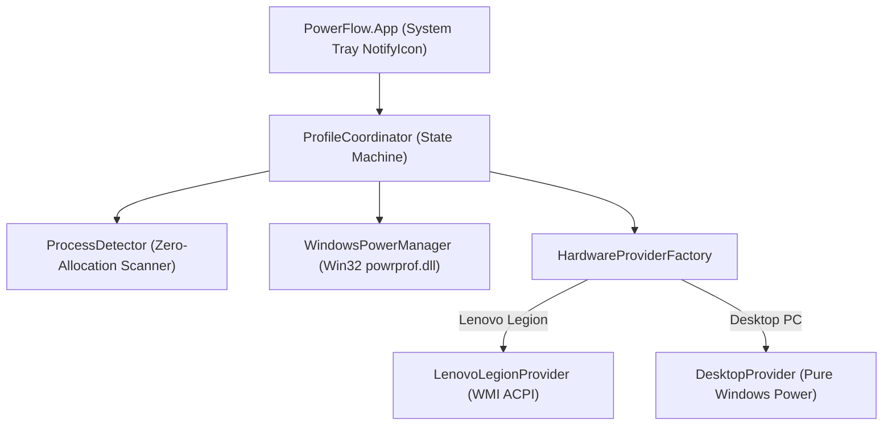

# PowerFlow

Lightweight, universal Windows power plan and hardware performance profile switcher for gaming laptops and PCs.

---

## Overview

PowerFlow automatically switches Windows power plans and OEM hardware thermal profiles when games start and exit.

Modern multi-core processors lock their minimum processor frequency to 100% when set to the Windows **High Performance** plan. This causes high temperatures (90 °C – 98 °C) and loud fan noise during desktop tasks. PowerFlow solves this problem:

* **Desktop Tasks:** Keeps Windows in **Balanced** mode. Processors drop voltage and enter low-power idle states (~40 °C – 50 °C).
* **Gaming:** Instantly switches Windows to **High Performance** and commands OEM cooling to maximum boost.
* **Game Exit:** Waits for an 8-second grace period, then smoothly restores **Balanced** mode.

---

## Features

* **Near-Zero System Footprint:** Uses less than 20 MB RAM and 0.0% CPU when idle.
* **Instantaneous Switching:** Uses native Win32 `powrprof.dll` C function calls (< 1 ms latency).
* **Universal Hardware Architecture:**
  * **Desktop PCs:** Universal Windows power plan and thread priority management.
  * **Lenovo Legion Laptops:** Controls hardware thermal modes (Quiet, Balance, Performance) via ACPI WMI.
  * **Extensible OEM Adapters:** Modular provider interface for ASUS, MSI, Acer, and Dell.
* **System Tray Control:** Modern dynamic system tray icon with live status, balloon tips, and manual override menus.
* **Smart Game Detection:** Detects games launched from Steam, Epic Games, Xbox, Riot, or custom process lists.
* **Grace Period Protection:** Prevents rapid profile toggling during game restarts or resolution changes.

---

## Architecture

PowerFlow is built using .NET 10 (`net10.0-windows`):



---

## Getting Started

### Prerequisites

* Windows 10 (version 19041+) or Windows 11 (64-bit).
* [.NET 10 Desktop Runtime](https://dotnet.microsoft.com/download) (x64).

### Installation

1. Download the latest release from the Releases page.
2. Extract the folder to a permanent location (for example: `C:\Tools\PowerFlow`).
3. Open PowerShell as Administrator in the `publish` directory.
4. Run the installation script:
   ```powershell
   .\Scripts\Install-Task.ps1
   ```
5. PowerFlow will register in Windows Task Scheduler and start automatically with Highest Privileges at logon without UAC prompts.

### Uninstallation

To remove the startup task:
```powershell
.\Scripts\Uninstall-Task.ps1
```

---

## Configuration (`appsettings.json`)

Configure games and timing in `appsettings.json`:

```json
{
  "PowerFlow": {
    "PollIntervalSeconds": 4,
    "ExitGracePeriodSeconds": 8,
    "GamingPowerPlanGuid": "8c5e7fda-e8bf-4a96-9a85-a6e23a8c635c",
    "DesktopPowerPlanGuid": "381b4222-f694-41f0-9685-ff5bb260df2e",
    "GamingHardwareProfile": 3,
    "DesktopHardwareProfile": 2,
    "GameDirectoryKeywords": [
      "steamapps\\common",
      "Epic Games",
      "XboxGames",
      "Riot Games",
      "Ubisoft Game Launcher",
      "GOG Galaxy\\Games"
    ],
    "CustomProcessNames": [
      "PAYDAY3-Win64-Shipping",
      "payday3"
    ]
  }
}
```

* **`PollIntervalSeconds`:** Time in seconds between process scans (default: 4).
* **`ExitGracePeriodSeconds`:** Delay in seconds after a game exits before reverting to Balanced (default: 8).
* **`GamingPowerPlanGuid`:** GUID of the gaming power plan (default: High Performance).
* **`DesktopPowerPlanGuid`:** GUID of the desktop power plan (default: Balanced).
* **`GamingHardwareProfile`:** Lenovo thermal mode for games (`3` = Performance / Red LED).
* **`DesktopHardwareProfile`:** Lenovo thermal mode for desktop (`2` = Balance / White LED).

---

## Development & Testing

### Build Solution
```powershell
dotnet build PowerFlow.slnx -c Release
```

### Run Unit Tests
```powershell
dotnet test PowerFlow.slnx
```

---

## License

This project is licensed under the GNU General Public License v3.0 - see the [LICENSE](LICENSE) file for details.
